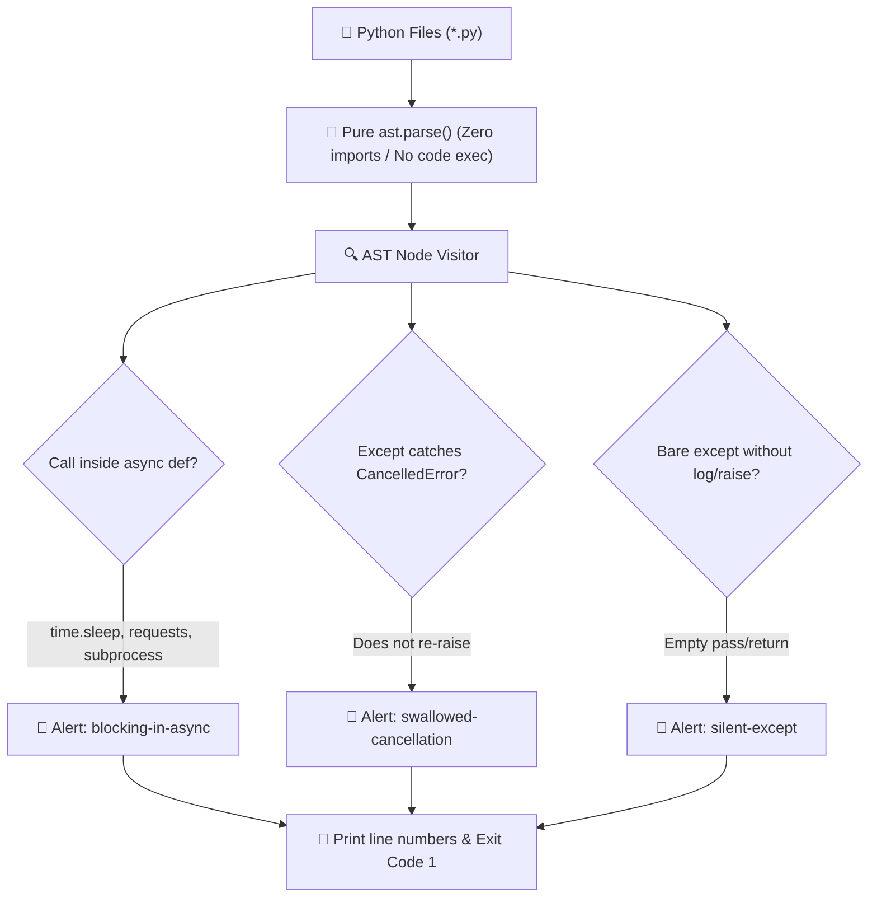

<div align="center">

# 🛡️ Cerberus-Gates (codegates)
### AST Static Regression Gates for Python: Stop Async Freezes & Silent Failures in CI

[](https://python.org)
[-purple.svg)](https://docs.python.org/3/library/ast.html)
[](https://github.com/Kaio-Comk/Cerberus-Gates)
[](https://github.com/Kaio-Comk/Cerberus-Gates)
[](https://opensource.org/licenses/MIT)

**Catch fatal Python anti-patterns in your syntax tree before they hit production.**  
*Reads AST without importing or executing files. Born from real high-traffic production incidents.*

[The 3 Core Gates](#-the-core-regression-gates) • [Architecture](#-how-ast-inspection-works) • [Installation](#-installation) • [CLI & CI Usage](#-cli--github-actions-usage) • [Pytest Integration](#-pytest-tripwire-integration)

</div>

---

## ⚡ The Core Regression Gates

Every gate was created in response to real production outages in high-concurrency systems:

| Check | Catches | Why It Kills Production |
|---|---|---|
| 🚫 **`blocking-in-async`** | `time.sleep`, `subprocess.run`, `requests.*`, `open()`, `Path.read_text()` inside `async def` | Freezes the **entire asyncio event loop** for all users simultaneously. |
| 🚫 **`swallowed-cancellation`** | `except (CancelledError, KeyboardInterrupt, SystemExit):` without re-raising | Creates zombie tasks that refuse to cancel, causing memory leaks and shutdown hangs. |
| 🚫 **`silent-except`** | Bare `except:` or `except Exception:` that neither logs nor re-raises | Features silently fail in production with zero logs, leaving developers completely blind. |

---

## 🔬 Bad vs. Good Code Patterns

### 1. `blocking-in-async`
```python
# ❌ INCIDENT: Freezes event loop for all concurrent connections
async def fetch_video(url: str):
    time.sleep(2)                     # Freezes loop!
    res = subprocess.run(["ffmpeg"])  # Freezes loop!

# ✅ CORRECT: Offload sync I/O to worker thread
async def fetch_video(url: str):
    await asyncio.sleep(2)
    await asyncio.to_thread(subprocess.run, ["ffmpeg"])
```

### 2. `swallowed-cancellation`
```python
# ❌ INCIDENT: Swallowing CancelledError prevents task termination
async def background_worker():
    try:
        await long_task()
    except asyncio.CancelledError:
        pass  # Zombie task keeps running in background!

# ✅ CORRECT: Cleanup and immediately re-raise
async def background_worker():
    try:
        await long_task()
    except asyncio.CancelledError:
        cleanup_resources()
        raise  # Critical: Propagate cancellation!
```

### 3. `silent-except`
```python
# ❌ INCIDENT: Silent pass masks critical bugs
try:
    save_user_order(order)
except Exception:
    pass  # Order dropped, zero logs, customer loses money!

# ✅ CORRECT: Log exception with traceback
try:
    save_user_order(order)
except Exception:
    logger.exception("Failed to persist order")
    raise
```

---

## 🏗️ How AST Inspection Works



---

---

## 💻 Hands-on Example & Output

### 1. Problematic Code (`app/service.py`)
```python
import time

async def fetch_user_data(user_id: int):
    # Freezes entire event loop for all concurrent connections
    time.sleep(2)
    return {"id": user_id, "status": "active"}
```

### 2. Scanner Detection
```bash
$ python -m codegates app/
app/service.py:5:4: [blocking-in-async] time.sleep inside async def freezes the event loop
1 finding(s)
$ echo $?
1
```

### 3. Verified Fix
```python
import asyncio

async def fetch_user_data(user_id: int):
    # Non-blocking: yields control back to event loop
    await asyncio.sleep(2)
    return {"id": user_id, "status": "active"}
```

### 4. Clean Run
```bash
$ python -m codegates app/
0 finding(s)
$ echo $?
0
```

---

## 📦 Installation

```bash
pip install git+https://github.com/Kaio-Comk/Cerberus-Gates.git
```

---

## 🚀 CLI & GitHub Actions Usage

### Run from Terminal
```bash
# Scan entire project (returns exit code 1 if violations found)
python -m codegates src/

# Run specific check while ignoring legacy directories
python -m codegates src/ --check blocking-in-async --skip migrations legacy
```

### GitHub Actions CI Workflow (`.github/workflows/lint.yml`)
```yaml
name: Regression Gates
on: [push, pull_request]

jobs:
  gates:
    runs-on: ubuntu-latest
    steps:
      - uses: actions/checkout@v4
      - uses: actions/setup-python@v5
        with:
          python-version: "3.12"
      - run: pip install git+https://github.com/Kaio-Comk/Cerberus-Gates.git
      - run: python -m codegates src/
```

---

## 🧪 Pytest Tripwire Integration

Add a dedicated test file to guarantee nobody ever commits an event loop blocking call or silent exception:

```python
# tests/test_code_gates.py
from codegates import scan

def test_no_event_loop_freezes():
    violations = scan("src", checks=["blocking-in-async"])
    assert violations == [], f"Found blocking calls inside async functions: {violations}"

def test_no_swallowed_cancellations():
    violations = scan("src", checks=["swallowed-cancellation"])
    assert violations == [], f"Found swallowed cancellation exceptions: {violations}"
```

---

## 📄 License

Distributed under the **MIT License**. See `LICENSE` for details.

<div align="center">
  <sub>Built with ❤️ by Kaio Lima. If Cerberus-Gates prevented an outage, please star ⭐ the project!</sub>
</div>
